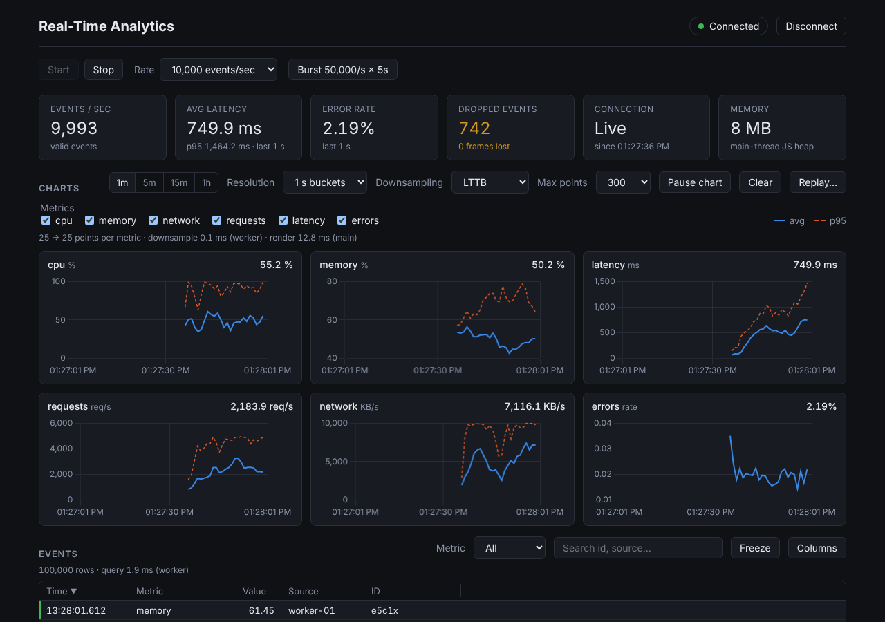
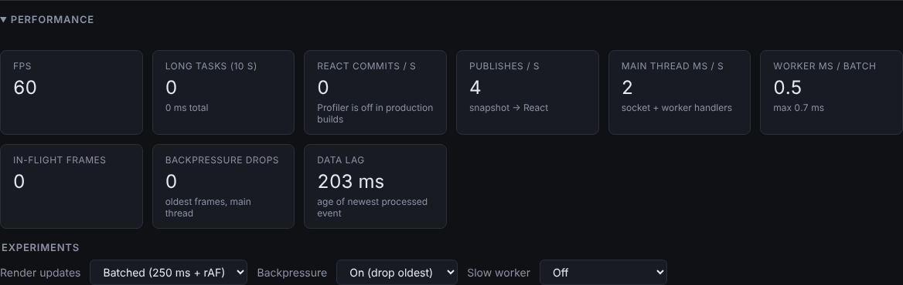
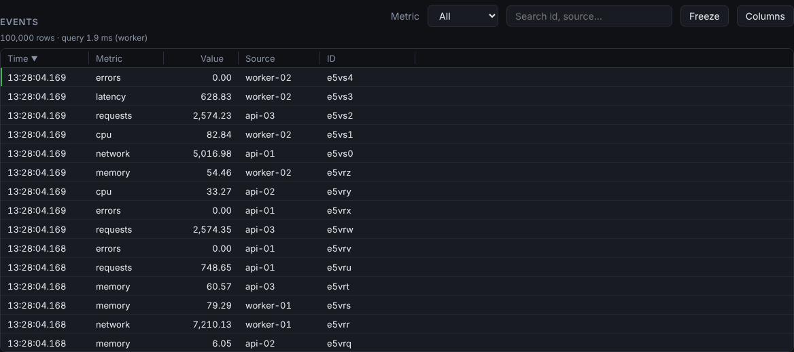

# Real-Time Analytics Dashboard

A browser dashboard that ingests **10K–50K events/second** over WebSocket and stays at **60 FPS**:
parsing, validation, aggregation and downsampling run in a Web Worker; the main thread renders
~4 times a second and draws only what's visible.



## Problem

A naive real-time dashboard parses every message on the main thread, re-renders React per message,
plots every point and puts every row in the DOM. Measured here, that version drops to **9 FPS** at
200 messages/s, takes **5 s to render 100K rows**, and falls **13 s behind live** when the consumer
can't keep up. This project removes each bottleneck and measures the result.

## Results (measured — see [PERFORMANCE.md](docs/PERFORMANCE.md))

| Problem                                          |                Naive |                                              This project |
| ------------------------------------------------ | -------------------: | --------------------------------------------------------: |
| Render per message vs batched + rAF (200 msgs/s) | 9 FPS, 162 renders/s |                                   **60 FPS, 4 renders/s** |
| 100K table rows in the DOM                       | 600K nodes, 5,077 ms |                                 **21 rows** (virtualized) |
| Chart: 17K points/metric vs LTTB → 1K            |      16–28 ms render | **5–8 ms**, keeps ~70% of error spikes (every-Nth: 4–10%) |
| Slow consumer, no backpressure                   |   lag grows to 13 s+ |                              **lag < 1 s**, drops counted |
| 50K events/s for 2 minutes                       |                    — |                   heap flat: main ~13 MB, worker 11–15 MB |
| Production bundle (gzip)                         |                    — |                                   130 KB JS + 6 KB worker |

Measured in headless Chromium (dev build unless noted). Re-measure on your machine with the
in-app **Performance** panel.

## Features

- **Streaming**: WebSocket client with exponential-backoff reconnect (+ jitter, heartbeat timeout,
  "retry now"), seq-gap detection, re-applies your settings after reconnecting
- **Worker pipeline**: parse → validate (with reasons) → 1 s / 5 s / 10 s / 1 min buckets with exact
  P95/P99 → LTTB downsampling → small summaries back to the UI
- **Backpressure**: in-flight budget + drop-oldest queue; server-side drops for slow sockets
- **Charts**: Chart.js small multiples, 1m–1h ranges, raw or bucketed, pause/clear, LTTB / every-Nth / none
- **Grid**: 100K live events, sort/filter/search in the worker, keyboard navigation, selection,
  column resize/visibility — ~20 DOM rows
- **Persistence**: IndexedDB history (30 min), reload recovery, **session replay** at 1–30×
- **Instrumentation**: FPS, long tasks, React commits, publishes/s, main/worker ms, in-flight, lag
- **Experiments in the UI**: naive vs batched rendering, backpressure on/off, slow-worker simulation
- **Leak Lab** (dev only): three classic leaks with fixes, for heap-snapshot practice
- **Quality**: 195+ unit/integration tests, Playwright E2E, axe accessibility (0 violations),
  CI with bundle-size and runtime performance gates

| Performance panel                                       | Virtualized grid                          |
| ------------------------------------------------------- | ----------------------------------------- |
|  |  |

## Architecture

```text
 Node.js WS server                Browser
 ┌──────────────┐   batch frames  ┌───────────── main thread ─────────────┐     ┌──────── Web Worker ────────┐
 │ generator    │ ──────────────▶ │ connection.ts                         │     │ parse → seq → validate     │
 │ 100–50K ev/s │   (JSON, 50 ms) │  prefix check: batch? ──▶ frameBuffer ├───▶ │ → aggregate (1s…1m, P95/99)│
 │ backpressure │ ◀────────────── │  control msgs parsed here             │ ack │ → 100K ring buffer         │
 │ rate limits  │   setRate/stop  │  backpressure budget (32 in flight)   │ ◀───┤ → LTTB / grid queries      │
 └──────────────┘                 │  stores: stats · chart · grid         │     │ → IndexedDB (1 s buckets)  │
                                  │      │ 250 ms check + rAF             │     └────────────────────────────┘
                                  │      ▼                                │
                                  │ React (useSyncExternalStore)          │
                                  │  KPIs · Chart.js · virtual grid       │
                                  └───────────────────────────────────────┘
```

Details: [ARCHITECTURE.md](docs/ARCHITECTURE.md) · every trade-off: [DECISIONS.md](docs/DECISIONS.md) (D1–D37)

## Tech stack

| Area    | Choice                                                                                  |
| ------- | --------------------------------------------------------------------------------------- |
| Web     | React 19, Vite 8, TypeScript 6.0, CSS Modules, Chart.js 4                               |
| Worker  | Dedicated module worker (own `tsconfig.worker.json`: DOM and WebWorker types can't mix) |
| Server  | Node 22, `ws` 8, `tsx` (dev), `tsup` (bundle)                                           |
| Storage | IndexedDB (history), localStorage (UI prefs)                                            |
| Tests   | Vitest 5 + Testing Library + fake-indexeddb · Playwright 1.64 + axe-core                |
| CI/CD   | GitHub Actions · Vercel (web) · Docker → GHCR / Azure App Service (server)              |

## Run it

```bash
npm install
npm run dev          # WS server on :8080 + dashboard on http://localhost:5173
```

Node `^20.19 || >=22.12`. On Windows this works in PowerShell as-is.

### Scripts (repo root)

| Command                                       | What it does                                                                  |
| --------------------------------------------- | ----------------------------------------------------------------------------- |
| `npm run dev`                                 | Server + web                                                                  |
| `npm run lint` · `format:check` · `typecheck` | Static checks (typecheck covers app, worker, e2e, server, shared)             |
| `npm test`                                    | Vitest: shared, server, web                                                   |
| `npm run build`                               | Production builds (web + server bundle)                                       |
| `npm run check:bundle`                        | Gzip budgets from `perf-budget.json` (after build)                            |
| `npm run test:e2e`                            | Playwright E2E + accessibility. First time: `npx playwright install chromium` |
| `npm run test:perf`                           | Runtime performance gate on the production build (build first)                |

### Environment variables

| Variable                                          | Where  | Default                 | Purpose                                               |
| ------------------------------------------------- | ------ | ----------------------- | ----------------------------------------------------- |
| `PORT`                                            | server | 8080                    | HTTP + WebSocket port (`/healthz` for health checks)  |
| `ALLOWED_ORIGINS`                                 | server | `http://localhost:5173` | Comma-separated browser origins; `*` = any (dev only) |
| `DEFAULT_RATE` / `MAX_RATE`                       | server | 1000 / 100000           | Events/sec at connect / ceiling                       |
| `TICK_MS`                                         | server | 50                      | Batch interval (5 → 200 frames/s for stress tests)    |
| `HEARTBEAT_MS`                                    | server | 5000                    | App-level heartbeat                                   |
| `MAX_BUFFERED_BYTES`                              | server | 8 MB                    | Drop frames for clients that can't keep up            |
| `BAD_EVENT_PCT` / `BAD_FRAME_PCT`                 | server | 0                       | Fault injection for validation tests                  |
| `AUTH_TOKEN`                                      | server | —                       | Auth placeholder (see SECURITY.md)                    |
| `CONTROL_RATE_PER_SEC` / `MAX_CONNECTIONS_PER_IP` | server | 10 / 20                 | Abuse limits                                          |
| `VITE_WS_URL`                                     | web    | `ws://localhost:8080`   | Server URL (`wss://…` in production)                  |
| `VITE_WS_TOKEN`                                   | web    | —                       | Must match `AUTH_TOKEN` when set                      |
| `VITE_BUFFER_MS`                                  | web    | 50                      | Frame buffer wait; 0 = no buffering (experiment)      |

## Repository layout

```text
apps/web          React dashboard, worker, e2e/ (Playwright), e2e-perf/ (perf gate)
apps/server       WebSocket server, generator, rate limiting, Dockerfile
packages/shared   Event types, validation, wire protocol
docs/             Architecture, decisions, performance, memory, security, accessibility, deployment
scripts/          Bundle-size gate
```

## Docs

[ARCHITECTURE](docs/ARCHITECTURE.md) · [DECISIONS](docs/DECISIONS.md) · [PERFORMANCE](docs/PERFORMANCE.md) ·
[MEMORY](docs/MEMORY.md) · [PROTOCOL](docs/PROTOCOL.md) · [SECURITY](docs/SECURITY.md) ·
[ACCESSIBILITY](docs/ACCESSIBILITY.md) · [DEPLOYMENT](docs/DEPLOYMENT.md) · [WBS](docs/WBS.md)
